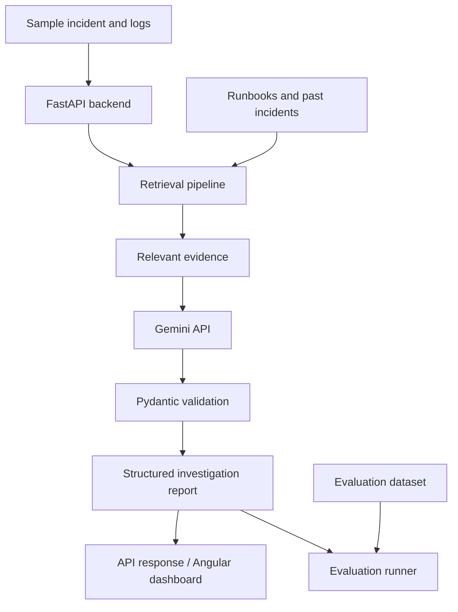

# Zero500

> **From HTTP 500 to root cause.**

Zero500 is an AI-powered incident investigation assistant designed to help developers understand application failures faster. It brings together synthetic incident data, application logs, runbooks, and previous incidents to produce **evidence-backed root-cause hypotheses and remediation recommendations**.

The project is being built as a practical AI engineering portfolio project, with a focus on more than just generating a plausible answer: the system should retrieve relevant evidence, return structured results, and make its investigation steps easier to inspect and evaluate.

> **Project status:** Work in progress. The initial FastAPI backend and synthetic incident-data scaffolding are being developed. Gemini-powered investigation, retrieval, evaluation, and deployment are planned milestones—not features to assume are complete yet.

---

## Why Zero500?

When an application starts returning HTTP 500 errors, the status code tells us that something failed, but not why. Engineers may need to correlate logs, recent changes, service dependencies, and operational documentation to find the cause.

Zero500 aims to make that investigation easier by:

- collecting relevant context for a selected incident;
- retrieving useful runbooks and similar past incidents;
- using a Gemini model to generate a structured diagnosis;
- showing the evidence behind the diagnosis instead of presenting an unsupported answer as fact; and
- providing a repeatable way to test the quality of its investigations.

Zero500 is intended as an **investigation assistant**, not an autonomous production operator. The initial version will use synthetic data and read-only workflows.

## Planned capabilities

- **Incident summaries:** View a concise summary of an incident and its associated logs.
- **Evidence retrieval:** Search runbooks, incident reports, and other relevant documents.
- **RAG-based investigation:** Provide retrieved evidence to Gemini when generating a diagnosis.
- **Structured reports:** Return fields such as suspected root cause, supporting evidence, confidence, and suggested next steps.
- **Source references:** Make it possible to trace explanations back to the relevant logs or documents.
- **Evaluation:** Run a known set of incidents to measure diagnosis quality, evidence relevance, and unsupported claims.
- **Dashboard:** Present incidents, investigation results, and evidence in a web interface.
- **Free-tier deployment:** Aim for a publicly accessible demo using providers' free tiers where available.

Features will be added incrementally. The roadmap below reflects the intended direction, not a claim that every item is available today.

## Intended architecture



### Intended technology stack

| Area | Technology | Purpose |
|---|---|---|
| Backend API | Python, FastAPI | HTTP endpoints and investigation workflow |
| Data validation | Pydantic | Validate request and response structures |
| LLM | Google Gemini API | Analyze retrieved incident context and generate reports |
| Retrieval | Embeddings and vector search | Find relevant runbooks and prior incidents |
| Database | PostgreSQL with pgvector (planned) | Store incident records and support vector retrieval |
| Frontend | Angular (planned) | Incident and evidence dashboard |
| Testing | pytest (planned) | Unit and integration tests |
| Deployment | Free-tier hosting options (planned) | Public portfolio demo, subject to provider limits |

The implementation may evolve as the project develops. The priority is to keep the system understandable, testable, and useful—not to add frameworks without a reason.

## Example workflow

1. A user selects a sample incident, such as an API beginning to return HTTP 500 errors after a deployment.
2. Zero500 loads the related synthetic logs and incident context.
3. The retrieval pipeline finds relevant runbook sections and similar historical incidents.
4. Gemini receives the incident details and retrieved evidence, with instructions to distinguish evidence from hypotheses.
5. The backend validates the output and returns a structured investigation report.
6. The user reviews the likely cause, supporting evidence, and suggested next steps.

A generated diagnosis is a hypothesis to investigate—not proof that a root cause has been found. The system should communicate uncertainty and avoid inventing evidence.

## Getting started

### Prerequisites

- Python 3.11 or a version supported by the project's dependencies
- `pip` and `venv`
- A Gemini API key from [Google AI Studio](https://aistudio.google.com/)
- Git

A database and frontend may not be needed for the initial backend-only milestone.

### 1. Clone the repository

```bash
git clone <your-repository-url>
cd Zero500
```

Replace `<your-repository-url>` with the URL of your GitHub repository. If your local directory has a different name, enter that directory instead.

### 2. Create and activate a virtual environment

**Windows PowerShell**

```powershell
python -m venv .venv
.\.venv\Scripts\Activate.ps1
```

**macOS / Linux**

```bash
python3 -m venv .venv
source .venv/bin/activate
```

### 3. Install dependencies

If the repository contains a `requirements.txt` file:

```bash
python -m pip install -r requirements.txt
```

If dependency setup is still being developed, install the packages listed by the project and add them to the dependency file so the environment can be reproduced. Avoid installing unrelated packages that the project does not use.

### 4. Configure environment variables

Create a local `.env` file for development if the application uses environment-based configuration. For example:

```dotenv
GEMINI_API_KEY=replace_with_your_own_key
GEMINI_MODEL=your_supported_gemini_model
DATABASE_URL=
```

Use a Gemini model available to your API project and compatible with the features you implement. Variable names may change as configuration is finalized.

**Never commit `.env` or a real API key.** Add `.env` to `.gitignore`, keep secrets in your hosting provider's environment settings, and use a placeholder-only `.env.example` for documentation.

### 5. Run the API

Once the application entry point and dependencies are in place, run the FastAPI app using its actual import path. For a typical project with `app/main.py` containing `app = FastAPI()`, the command is:

```bash
uvicorn app.main:app --reload
```

Open the API documentation at `http://127.0.0.1:8000/docs` to inspect the available endpoints. If the project's entry point differs, adjust the Uvicorn import path to match it.

## Development roadmap

- [x] Establish the project direction and initial FastAPI application scaffolding
- [ ] Finalize health and synthetic-incident endpoints
- [ ] Add request/response schemas and API error handling
- [ ] Integrate the official Google Gen AI SDK with Gemini
- [ ] Build document ingestion and chunking
- [ ] Add embeddings and vector retrieval
- [ ] Generate evidence-backed, structured incident reports
- [ ] Add source references and uncertainty handling
- [ ] Create a repeatable incident evaluation dataset
- [ ] Build the Angular dashboard
- [ ] Add request limits, logging, tests, and failure handling
- [ ] Deploy a public demo using available free tiers

## Evaluation goals

Zero500 should be evaluated on defined examples rather than on a few impressive demos alone. Planned measures include:

- **Diagnosis accuracy:** Does the proposed cause match the known incident scenario?
- **Evidence relevance:** Did retrieval find the logs or runbook sections needed for the diagnosis?
- **Evidence support:** Are the report's claims grounded in the retrieved material?
- **Unsupported-claim rate:** How often does the model assert details that the evidence does not support?
- **Reliability:** Does the API handle malformed input, timeouts, and model errors predictably?
- **Latency and usage:** How long does an investigation take, and how many model calls does it require?

These are goals for the evaluation suite; results should only be reported after they have been measured.

## Security and responsible use

- Use synthetic or explicitly authorized data. Do not upload confidential production logs, credentials, personal data, or customer information to the demo.
- Keep the Gemini API key on the server. Never expose it in frontend code or a public repository.
- Apply server-side request limits and bound input size, model calls, retries, and execution time.
- Treat logs, documents, and retrieved text as untrusted input; they may contain misleading instructions or prompt-injection attempts.
- Start with read-only integrations. Do not execute remediation commands automatically.
- Require explicit human approval before any future feature performs a consequential action.
- Do not treat the model's confidence estimate as a calibrated probability unless it has been tested and calibrated.

## Cost and deployment goal

The target is a **₹0 portfolio demo**, using Gemini API Free Tier access and hosting/database free tiers where eligible. This is a goal, not a guarantee: quotas, eligibility, service limits, cold starts, and provider policies may change. Public access must be rate-limited to protect the API quota, and paid billing should remain disabled if a hard zero-spend constraint is required.

The free-tier version is intended for low-volume demonstrations, not guaranteed uptime or production incident response.

## Contributing

This project is under active development. Suggestions, bug reports, and pull requests are welcome. For substantial changes, open an issue first so the scope and design can be discussed.

## License

No license has been selected yet. Unless a license is added to the repository, reuse and redistribution are not automatically granted. Add a `LICENSE` file before explicitly inviting others to reuse or distribute the code.

---

**Zero500 — from HTTP 500 to root cause.**